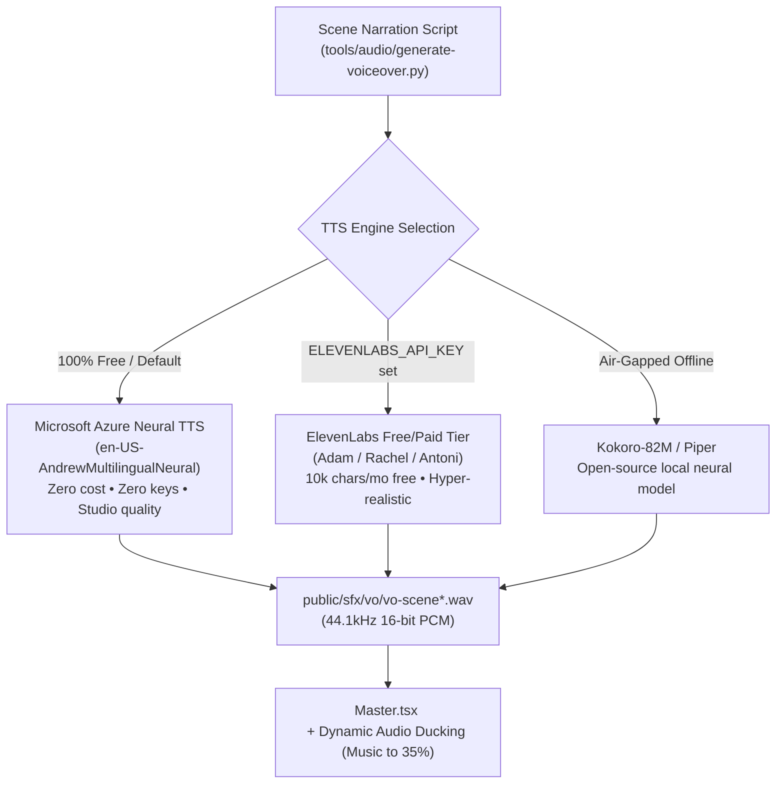

# Motion Graphics & AI Demo Video Studio

A cohesive, end-to-end toolkit for building studio-grade AI motion graphics and product demo videos with **Remotion**, **Playwright CDP screen capture**, **deterministic WebGL/3D frame-stepping**, **Whisper word-cue timing**, **procedural SFX/beat grids**, **per-pixel directional motion blur**, and **-14 LUFS broadcast mastering**.

Combines six open-source repositories—including the exact blueprint behind [`mFCAcvSXj48`](https://www.youtube.com/watch?v=mFCAcvSXj48), official Remotion Agent Skills, 81 reusable Remotion templates, finished showcase compositions, and a unified `starter/` Remotion project—into one ready-to-run workflow.

---

## 7-Stage Production Workflow

1. **Creative Direction & Storyboarding** (`remotion-video-director`, `starter/docs/prompts/`) — Lock narrative arc, aesthetic preset, beat budget, and shot list before writing scene code.
2. **Real Product & 3D Capture** (`starter/tools/record/`, `starter/tools/capture-3d/`) — Capture real UI flows at constant frame rate via Playwright CDP with simulated cursor/drags, or step deterministic WebGL/Three.js scenes frame by frame into lossless clips.
3. **Voiceover, Beat Grid & Procedural SFX** (`starter/tools/audio/`) — Synthesize zero-dependency SFX (`npm run sfx:gen`) and electronic music beds (`npm run track:gen`), extract beats (`detect-beats.py`), score TTS takes with Whisper WER (`voice-make.py`, `voice-pick-takes.py`), and align internal events (`align-internal-events.py`).
4. **Compose in Remotion Studio** (`starter/src/`, `templates/`) — Build scenes anchored to `timing.ts` beat math, Whisper word-cue timelines (`src/lib/whisper-cue.ts`), CAD drawing sheets (`DrawingSheet.tsx`), karaoke captions (`WhisperCaptions.tsx`), film atmosphere (`Atmosphere.tsx`), and 81 drop-in effects from `templates/remotion-templates/`.
5. **Automated Visual & Pacing QA** (`starter/tools/stills.mjs`, `starter/tools/qa/`) — Dump scene timings (`npm run timing`), check reading speed (`npm run copy:check`), verify WCAG contrast (`check-contrast.py`), inspect scene cuts on contact sheets (`node tools/stills.mjs Master cuts --sheet out/cuts.png`), and flag sudden frame jerks (`jerk.py`).
6. **Sub-Frame Shutter Motion Blur** (`starter/tools/mb/`) — Sample intermediate sub-frames via `Master-Sub` + `SubClock.tsx` and blend high-velocity segments per frame (`sample.mjs`, `plan.py`, `blend.py`, `encode.sh`).
7. **Master & Deliver** (`starter/tools/finish.sh`) — Render at CRF 16 and master audio in two EBU R128 passes to `-14 LUFS` / `-1 dBTP` plus a 720p web derivative (`npm run finish`).

---

## Quick Start

### 1. Install the 4 Agent Skills Globally (Optional, Recommended)

Installs `remotion-best-practices`, `saas-product-demo-video`, `remotion-video-director`, and `remotion-motion-graphics` into `~/.agents/skills`, `~/.gemini/config/skills`, and `~/.claude/skills`:

```bash
bash scripts/install-skills.sh
bash scripts/install-skills.sh --check
```

To install into another repo instead of your home directory:

```bash
bash scripts/install-skills.sh --project /path/to/your-repo
```

### 2. Boot the Unified Remotion Studio

```bash
cd starter
npm install
npm run typecheck
npm run sfx:gen      # writes synthesized WAV SFX kit to public/sfx/
npm run track:gen    # writes 20s 120 BPM backing track to public/sfx/track.wav
npm run dev          # launches Remotion Studio preview
```

### 3. Common Studio & Mastering Commands

Run from `starter/`:

| Command | Purpose |
|---|---|
| `npm run typecheck` | Strict TypeScript check (`tsc --noEmit`) |
| `npm run vo:gen` | Synthesize natural neural voiceover tracks (`tools/audio/generate-voiceover.py`) |
| `npm run timing` | Write scene/beat boundaries to `out/timing-dump.json` |
| `npm run copy:check` | Check on-screen words/sec pacing against targets |
| `npm run still` | Render the final frame of `Scene-Example` to PNG |
| `node tools/stills.mjs Master cuts --sheet out/cuts.png` | Render first/last frames per scene into a contact sheet (requires Pillow) |
| `npm run render` | Render `Master` composition to `out/master.mp4` |
| `npm run finish` | Render + two-pass `-14 LUFS` FFmpeg master + 720p web copy (`tools/finish.sh`) |

> **Note:** Optional Python/FFmpeg stages (`tools/audio/detect-beats.py`, `tools/mb/`, `tools/finish.sh` normalization, `tools/qa/sample-reference-frames.sh`) expect `ffmpeg`, `ffprobe`, and Python packages (`numpy`, `pillow`, `librosa`, `openai-whisper`, etc.) as needed per stage.

---

## 🎙️ Natural AI Voiceover Integration (Free & Studio Tiers)

Standard OS text-to-speech (such as basic macOS `say` or Linux `espeak`) sounds robotic because it lacks natural breathing, micro-pauses, and emotional pitch inflections. This studio integrates a **multi-tier neural voiceover engine** in `starter/tools/audio/generate-voiceover.py`:



### 1. Option A: Microsoft Edge Neural TTS (⭐ Recommended — 100% Free Forever)
- **Zero API keys, zero signup, and unlimited usage**.
- Powered by Microsoft's Azure Speech Neural engine (the same voices used in Microsoft Copilot).
- Warm, natural human breathing and conversational cadence.
- **Top Voices:**
  - `en-US-AndrewMultilingualNeural` *(Default)* — Warm, confident Silicon Valley tech presenter.
  - `en-US-ChristopherNeural` — Deep, cinematic documentary / movie trailer voice.
  - `en-GB-RyanNeural` — Crisp, modern British tech founder voice.
  - `en-US-AriaNeural` — Expressive, articulate, professional female narrator.

Generate natural voiceovers instantly:
```bash
cd starter
python3 tools/audio/generate-voiceover.py
# Or with another voice:
VOICE="en-US-ChristopherNeural" python3 tools/audio/generate-voiceover.py
```

### 2. Option B: ElevenLabs (Studio Quality with Free Tier)
- Industry standard for emotional range, realistic micro-pauses, and actor-grade vocal delivery.
- **Free Tier gives 10,000 characters per month** (sufficient for ~25 to 30 complete 20–30 second product demo videos every month).
- Grab a free key from [elevenlabs.io](https://elevenlabs.io) and run:
```bash
ELEVENLABS_API_KEY="your-elevenlabs-key" python3 tools/audio/generate-voiceover.py
```

### 3. Dynamic Audio Ducking & Remotion Integration
When voiceover is enabled in `src/Master.tsx`, the 120 BPM dark-electronic soundtrack automatically **ducks to 35% volume** during speech segments so the voice stands out crystal-clear, then swells back to full volume (60%) on scene transitions and beat drops.

For full architectural details, script tuning, and speech-rate formulas, see [`starter/docs/video/voiceover-guide.md`](starter/docs/video/voiceover-guide.md).

---

## Repository Structure

```text
motion-graphics-demo-video/
├── .agents/skills/                   # 4 portable SKILL.md agent packages
│   ├── remotion-best-practices/      # Official Remotion router + 12 sub-skills (Remotion License)
│   ├── saas-product-demo-video/      # Beat-synced SaaS demo workflow, QA & motion blur rules
│   ├── remotion-video-director/      # 4-phase creative direction & storyboard deliberation loop
│   └── remotion-motion-graphics/     # Motion-graphics examples & spring/caption patterns
├── .claude/skills -> ../.agents/skills
├── scripts/
│   └── install-skills.sh             # Installs the 4 skills globally or into any project
├── starter/                          # Cohesive runnable Remotion Studio workspace
│   ├── docs/prompts/                 # Script, voice, music, and review prompt templates
│   ├── public/                       # Static assets (SFX, music tracks, captured clips)
│   ├── src/
│   │   ├── lib/whisper-cue.ts        # Whisper word-cue sync, karaoke chunking helpers & ducking
│   │   ├── components/               # 16 SaaS demo primitives + DrawingSheet, WhisperCaptions, Atmosphere
│   │   ├── scenes/ExampleScene.tsx   # Beat-synced starter composition
│   │   ├── Master.tsx / Root.tsx / timing.ts / theme.ts / easings.ts / SubClock.tsx
│   └── tools/
│       ├── finish.sh                 # CRF 16 render + two-pass EBU R128 (-14 LUFS) mastering
│       ├── dump-timing.mjs / stills.mjs / sheets.py / jerk.py
│       ├── record/                   # Playwright CDP CFR H.264 UI capture + simulated cursor
│       ├── capture-3d/               # Deterministic 4K -> 1080p Three.js frame stepper
│       ├── audio/                    # Beat detection, procedural SFX/tracks, Chatterbox + Whisper QA
│       ├── mb/                       # Sub-frame velocity planning & pixel motion blur blending
│       └── qa/                       # Copy budget, contrast check, reference teardown, side-by-side
├── templates/
│   ├── remotion-templates/           # 81 standalone animated Remotion TSX components (MIT)
│   └── claude-remotion-examples/     # Finished promo/code/demo cuts & scripts (MIT)
├── blueprints/
│   ├── basement-ready/               # Reference codebase behind YouTube mFCAcvSXj48 (MIT)
│   └── saas-product-demo-video/      # Upstream evals, plugin metadata & scaffold tests (MIT)
└── THIRD_PARTY_NOTICES.md            # Complete upstream credits, commits & license terms
```

---

## Included Agent Skills

| Skill | Responsibility | Path |
|---|---|---|
| `remotion-best-practices` | Official Remotion API syntax, `<Sequence>`, `<TransitionSeries>`, captions, maps, 3D, rendering, licensing | [`.agents/skills/remotion-best-practices/SKILL.md`](.agents/skills/remotion-best-practices/SKILL.md) |
| `saas-product-demo-video` | End-to-end SaaS demo pipeline, beat math, visual QA stills/sheets, real motion blur | [`.agents/skills/saas-product-demo-video/SKILL.md`](.agents/skills/saas-product-demo-video/SKILL.md) |
| `remotion-video-director` | Interactive Think → Design → Build → Review deliberation loop with creative presets | [`.agents/skills/remotion-video-director/SKILL.md`](.agents/skills/remotion-video-director/SKILL.md) |
| `remotion-motion-graphics` | Opinionated SaaS motion-graphics patterns, procedural audio generation, spring presets | [`.agents/skills/remotion-motion-graphics/SKILL.md`](.agents/skills/remotion-motion-graphics/SKILL.md) |

---

## Credits & Licensing

Original repository glue, integrated `starter/` adaptations, and setup scripts are licensed under the MIT License where permitted by upstream licenses. Third-party upstream repositories retain their original copyrights and licenses (**MIT** for five upstream repositories; **Remotion License** for `remotion-dev/skills` and Remotion packages).

See [`THIRD_PARTY_NOTICES.md`](./THIRD_PARTY_NOTICES.md) for pinned commit hashes, upstream URLs, copyright holders, and license texts.
